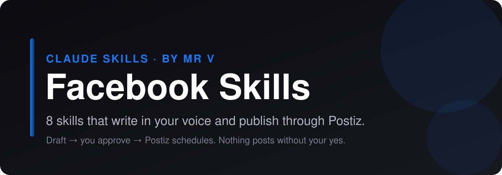

<p align="center">
  
</p>

# Facebook Skills for Claude Code, Claude.ai and Codex

<p align="center">
  
  
  
  
  
</p>

**Claude skills for Facebook.** 8 skills that plan, write, scrub and publish your Facebook content. They draft in your voice, strip the AI tells, and hand finished posts to [Postiz](https://postiz.com) for scheduling, only after you approve. No coding required.

> **On another platform too?** Matching bundles: [LinkedIn](https://github.com/mrvsubstack/linkedin-skills) · [X (Twitter)](https://github.com/mrvsubstack/x-skills) · [Instagram](https://github.com/mrvsubstack/instagram-skills) · [Threads](https://github.com/mrvsubstack/threads-skills) · [YouTube](https://github.com/mrvsubstack/youtube-skills) · [TikTok](https://github.com/mrvsubstack/tiktok-skills) · [Pinterest](https://github.com/mrvsubstack/pinterest-skills) · [Reddit](https://github.com/mrvsubstack/reddit-skills). Same voice rules, same approve-before-publish flow.

> **Want the full library?** These are a free sample of the Mr V Skills library: 240+ skills for writing, newsletters, offers, ads, SEO and research. [Get it on Substack →](https://promptwithjason.substack.com)

## Install

### Claude.ai (web) or Claude Desktop

1. Click **Customize** in the sidebar and open **Plugins**
2. **Add** → **Add marketplace** → **Add from a repository**
3. Paste `mrvsubstack/facebook-skills` and sync
4. Open **Discover**, find **facebook-skills**, click **+** to install
5. Start a new chat and ask for a Facebook post

> Plugins need a paid Claude plan with code execution turned on.

### Claude Code

```
/plugin marketplace add mrvsubstack/facebook-skills
/plugin install facebook-skills@facebook-skills
```

Or clone it and open the folder. The `.claude/skills/` folder points at every skill, so they load with no install:

```bash
git clone https://github.com/mrvsubstack/facebook-skills.git
cd facebook-skills
```

### Any agent (Codex, Cursor and others)

```bash
npx skills add mrvsubstack/facebook-skills
```

Or point your agent at `skills/*/SKILL.md`. Each one is plain markdown.

> **Found this useful? [Star the repo](https://github.com/mrvsubstack/facebook-skills).** It's how the next person finds it.

## What you can do

Ask in plain English. The right skill picks itself.

**Write a post:**
> "Write a Facebook post for my bakery page that gets people commenting."

**Plan the week:**
> "A weekly Page and group plan for a local gym."

**Break down a winner:**
> "Why did this Facebook post go viral? [paste]"

**Ship it:**
> "Schedule this to my Facebook Page through Postiz for Sunday 7pm."

Every skill shows you a draft first. Nothing goes out until you say yes.

## The 8 skills

| Skill | What it does |
|---|---|
| **Post Writer** (`fb-post-writer`) | Writes Facebook posts for a Page, a profile or a Group, built to earn comments and shares rather than passive likes. Picks one of 10 post shapes by goal (short opinion, small number, easy question, this-or-that, relatable moment, behind the scenes, useful tip, story with a turn, human announcement, spotlight), leads short and only goes long on purpose. |
| **Content Planner** (`fb-content-planner`) | Builds a weekly Facebook plan for a Page, a Group or both: content pillars with weights, a day-by-day grid (post shape, angle, goal, time), a short-to-story mix, Group prompts and a daily reply routine, then runs a balance check so the week isn't all promotion or all questions. |
| **Engagement Drafter** (`fb-engagement-drafter`) | Drafts replies to comments on your Facebook posts, and helpful comments on other people's posts and Groups, in your voice. Sorts comments by type (question, praise, complaint, win, troll), picks one of 6 reply moves for each and writes 1 to 3 short variants you paste in yourself. |
| **Page Optimizer** (`fb-page-optimizer`) | Audits a Facebook Page and rewrites what's failing: action button, intro and About, category, Page name, username and URL, featured or pinned post, cover photo, profile picture, and contact and link fields. Returns a 9-part scorecard, fixes ranked by impact and before → after rewrites matched to your goal (followers, leads, sales or community). |
| **Hook Extractor** (`fb-hook-extractor`) | Breaks down why a Facebook post took off: names its shape (from the 10 Facebook post shapes), maps its hook line, body beats and close, explains the comment and share triggers, flags anything you shouldn't copy, and hands back a fill-in template for your own topic. Works from pasted post text plus any visible numbers. |
| **Repurposer** (`fb-repurposer`) | Rebuilds content you already made (a LinkedIn post, X thread, blog, newsletter, YouTube script or Instagram caption) as a native Facebook post for a Page, profile or Group. Finds the one idea worth keeping, picks a Facebook post shape, warms the tone, puts the whole point above the See more fold, handles links and strips off-platform clutter. |
| **Humanizer** (`fb-humanizer`) | Cleans the AI tells out of a Facebook post, comment or Group post: scores machine vocabulary by density, kills reveal bridges, staged staccato, stacked triads, corporate openers and announced honesty, then adds one real human detail and checks it didn't over-correct. Also has an audit mode (pass/fail before posting) and a voice-capture mode. |
| **Postiz Publisher** (`fb-postiz-publisher`) | Checks a finished post against Facebook's rules, shows you an approval card, and schedules it through Postiz after you say yes. Saves a copy-ready file when Postiz isn't set up. |

Some skills suggest companion skills from the other platform bundles or from the [full Mr V library](https://promptwithjason.substack.com) (for example `voice-profile-bank` or `final-edit-modes`). They're optional. Without them, each skill still does its whole job.

## Publish with Postiz

By default the skills hand you a copy-ready post. Connect [Postiz](https://postiz.com) and Claude can schedule it for you.

**Why Postiz:** it's open source, you can self-host it for free, and one account covers Facebook plus 25+ other channels. The hosted plan works too.

**Setup (5 minutes):**

1. Create a Postiz account (or self-host it) and connect Facebook under **Add Channel**.
2. Copy your API key from **Settings** → **Public API**.
3. Save it as an environment variable, not in the chat:
   ```bash
   export POSTIZ_API_KEY="your-key"
   # self-hosted only:
   export POSTIZ_API_URL="https://your-domain/api/public/v1"
   ```
4. Restart Claude and ask: **"List my Postiz channels."**

Full guide: [`skills/fb-postiz-publisher/references/postiz-setup.md`](skills/fb-postiz-publisher/references/postiz-setup.md).

**How a post ships:**

1. A writer skill drafts the post.
2. You edit until you like it.
3. `fb-postiz-publisher` checks it against Facebook's limits and shows an approval card: account, local time and UTC, media, exact text.
4. You say yes. It schedules through Postiz and gives you the post id.

No key? It saves the post to `post-ready-to-paste.txt` instead. Nothing breaks.

**Not published through Postiz:** Comments, replies and group posts (Postiz publishes to Pages). The engagement drafter hands you a copy-ready block.

## Voice rules every skill follows

1. A number or a statement in line 1. Never open on a question.
2. Odd precision beats round numbers: "$4,730" reads like a receipt, "$5k" like a guess.
3. One real detail per post. If you didn't give one, the skill asks. It never invents one.
4. No stock AI words (leverage, robust, elevate, navigate, foster, delve).
5. No reveal bridges ("Here's the thing", "Plot twist:") and no staccato stacks ("Simple. Fast. Done.").
6. Em dashes capped at about one per 100 words.

## Troubleshooting

| Problem | Fix |
|---|---|
| Skills don't activate | Start a new chat after installing. In Claude Desktop, check the plugin is listed under **Yours**, not only **Discover**. |
| "Postiz isn't connected" | `POSTIZ_API_KEY` isn't visible to Claude. Set it in your shell profile, open a new terminal, restart Claude. |
| 401 from Postiz | The key is wrong or was regenerated. Copy it again from Settings → Public API. |
| 429 from Postiz | You hit Postiz's hourly posting limit. Wait and try again. |
| Facebook channel not found | Connect it in the Postiz dashboard, or reconnect it if it shows as disabled. |
| Validation error on a post | A required platform setting is missing. The publisher reads the error and asks you for it. |

## Credits and license

Several skills here were rewritten in Mr.V's own words from methods in Serge Bulaev's MIT-licensed [facebook-skills](https://github.com/sergebulaev/facebook-skills). See [CREDITS.md](CREDITS.md).

MIT licensed. See [LICENSE](LICENSE). Not affiliated with Facebook or Postiz.

Made by **Mr.V** · [Substack](https://promptwithjason.substack.com)
